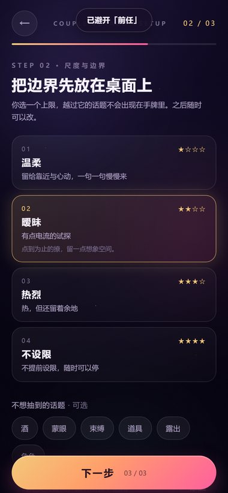
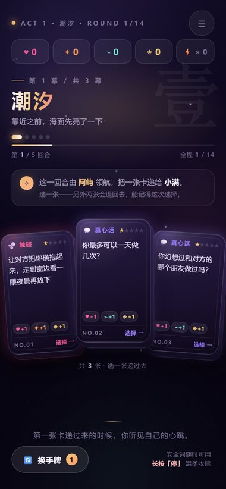
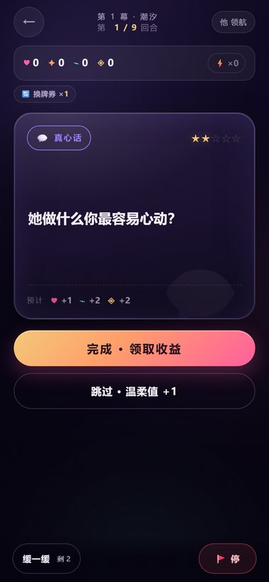
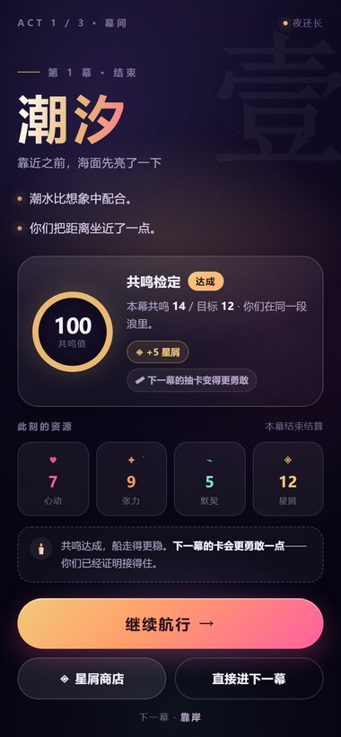
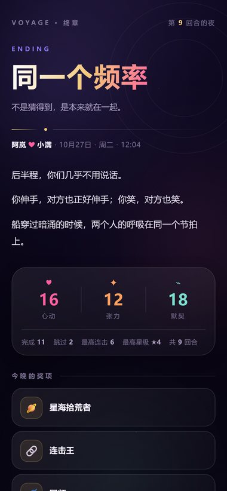
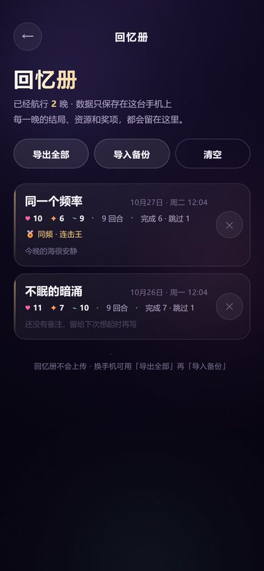
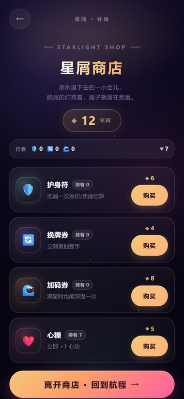
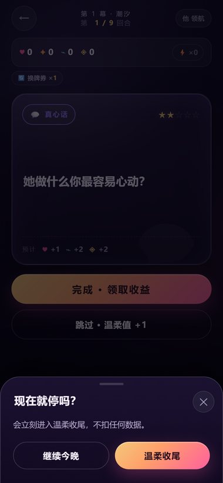

# 🌙 升温夜航 · Couple Voyage

> 一款**双人轮流领航的叙事卡牌游戏**。一台手机，三幕夜航，六种结局。
> 不是小游戏合集——是一个晚上只发生一次的完整旅程。


## 这是什么

> 「今晚，你们登上一艘只在夜里出现的船。航线有三段：潮汐、暗涌、靠岸。
> 每一张卡，都是海面递来的一句话。你可以回答，也可以跳过——船会记得你们怎么选择。」

- 🎴 **1423 张卡**：真心话 / 大冒险 / 触碰 / 共鸣 / 深潜 / 惩罚（文本复用旧版题库，按新规则重排打星）
- 🎭 **三幕结构**：潮汐（试探）→ 暗涌（升温）→ 靠岸（交融），每幕结束有事件、结算与星屑商店
- 🎲 **每回合三选一**：领航员从 3 张手牌里挑 1 张递过去；完成 / 跳过 / 加码深潜
- 💞 **三资源 + 星屑**：心动 ♥、张力 ✦、默契 ⌁，连击、换牌券、护身符、加码券
- 🌅 **六种结局**：由你们这一晚的资源曲线与选择决定；结束生成可保存的海报
- 📖 **回忆册**：每张船票留档（结局/资源/奖项），支持导出/导入全部数据
- 📲 **PWA**：添加到主屏幕全屏玩，断网也能继续；数据只在本机
- 🚩 **安全词常驻**：长按「停」1.5 秒立刻温柔收尾，不扣数据、不评判

## 今晚怎么玩

1. **设置**：两个人的称呼 → 尺度（温柔 / 暧昧 / 热烈 / 不设限）与边界 → 航程长度（9 / 14 / 18 回合）
2. **领航**：轮流当领航员，从 3 张手牌中选 1 张，完成它、跳过它，或完成后「加码深潜」
3. **靠岸**：三幕后进入结局，生成海报、存进回忆册；明晚可以继续新的航程

> 不用一次玩完：进度自动保存，首页「继续今晚」随时接上。

## 玩法机制

| 机制 | 规则 |
|---|---|
| 完成 | 按卡牌类型与星级获得资源；连击 +1 |
| 跳过 | 连击归零、张力 -1（≥0），温柔值 +1；不会因此卡关 |
| 加码 | 完成后抽一张 ★+1 深潜卡，收益 ×2；满星时需要「加码券」 |
| 缓一缓 | 对当前卡降 1 星，每局 2 次 |
| 连击 | 每 3 连额外星屑；每 5 连送 1 张随机券 |
| 幕末 | 共鸣检定（达标得星屑/券）；未达标下一幕手牌会自动温柔一档 |
| 商店 | 幕间用星屑买护身符 / 换牌券 / 加码券 / 心糖 |
| 结局 | 安全词 → 温柔 → 默契 → 张力 → 心动 → 兜底，六种结局按优先级判定 |

- **尺度**：`maxStar` 1–4 控制手牌星级上限；严格露骨词强制 ≥4 星，所以温柔档不会被重口卡砸场。
- **边界**：可勾选标签（束缚/露出/道具/喝酒/蒙眼/角色）或自定义关键词加入黑名单；柔和模式限制 ★≤2。
- **安全词**：任意页面（play 时在底部）长按「停」→ 立即进入「温柔收尾」结局，不扣数据。

## 六种结局

| 结局 | 触发方向 |
|---|---|
| 🌊 海面下的拥抱 | 使用了安全词（温柔收尾） |
| 🌤 慢一点，也很靠近 | 温柔值 ≥3 且心动 ≥6 |
| 🪢 同一个频率 | 默契 ≥12 且心动 ≥8 |
| 🔥 不眠的暗涌 | 张力 ≥18 |
| 🌅 天亮之前 | 心动 ≥14 |
| 🌫 各自听见的海 | 以上都不满足 |

## 截图

<p>
  
  
  
  
</p>
<p>
  
  
  
  
</p>

## 立即游玩

👉 **https://chundongtou.github.io/couple-game/**

手机浏览器打开后建议「添加到主屏幕」：全屏、离线可玩。
> 微信/QQ 内置浏览器可能限制安装，建议用 Safari / Chrome 打开。

## 开发

```bash
# 题库（从旧版 raw.json 重新生成 cards.js；改分类/打星后跑）
python tools/rebuild/make_cards.py

# 开发构建 + 本地预览（禁缓存）
python tools/rebuild/build_app.py --out dist/rebuild
python tools/rebuild/dev_app.py --port 8877 --out dist/rebuild --no-build

# 生产构建（写 repo 根 index.html，单文件，含 manifest/sw/icons）
python tools/rebuild/build_app.py --release

# 引擎单测（Node）
node qa/rebuild/engine.test.mjs

# E2E（Playwright）
python qa/rebuild/e2e.py --dist dist/rebuild
```

目录：

```
app/DESIGN.md            设计文档（世界观/规则/引擎 API/验收标准）
app/index.template.html  单文件模板
app/src/core/            util / bus / store / ui / motion / audio / safe
app/src/engine/          纯逻辑引擎 + 数值（balance.js）+ API 文档
app/src/content/         三幕文案 / 事件 / 结局 / 奖项
app/src/data/cards.js    1423 张卡（由 tools/rebuild/make_cards.py 生成）
app/src/ui/screens/      boot/setup/journey/play/event/act/shop/finale/memory/settings
app/src/ui/pwa.js        Service Worker 注册 / 安装入口
tools/rebuild/           构建、预览、题库生成脚本
qa/rebuild/              引擎单测 + E2E 验收
docs/REBUILD.md          构建/部署/改数值细节
```

### 改哪里

| 想改 | 位置 |
|---|---|
| 数值/阈值/商店价格/结局条件 | `app/src/engine/balance.js` |
| 三幕文案 / 事件 / 结局 / 奖项 | `app/src/content/content.js` |
| 题库分类/打星 | `tools/rebuild/make_cards.py` 后重新生成 |
| 界面/交互 | 对应 `app/src/ui/screens/<screen>.js`（每屏自带 CSS） |
| 设计令牌/公共组件 | `app/src/styles/base.css`、`app/src/core/ui.js` |

> 构建顺序、PWA 缓存、部署与回滚见 [docs/REBUILD.md](docs/REBUILD.md)。

## 重制说明（V3）

- **玩法、引擎、界面、动画全部重写**：从「29 个小游戏拼盘」改成「一局三幕的叙事卡牌」。
- **只复用旧版题库文本**（`app/data/raw.json`，提取自旧版 V17），按新规则重新分类、打星、去重（1423 张）。
- 旧版（V17/V18）代码仍在 git 历史与 `v17/ v18/` 目录中，未接入新构建；线上以本重制版为准。
- 引擎与内容解耦：`App.Engine` 纯逻辑可单测（236 assertions），UI 只读状态、播放事件。

## 隐私

- 全部数据（设置、存档、回忆册）只存在浏览器 `localStorage`（键前缀 `couple2.`）。
- 无账号、无后端、无统计上报；「清除所有数据」在设置里。
- 回忆册支持导出 JSON 备份 / 导入恢复。

## 安全提示

- 成人向内容，请双方**自愿参与**；任何一方随时可以使用安全词。
- 喝酒玩法请适量，未成年人请勿饮酒。
- 尊重彼此边界：设置里的尺度、黑名单、柔和模式都可以随时调整。

## License

MIT

---

<sub>V3.0.0 · 引擎 1.0.0 · 1423 cards · 3 acts · 6 endings</sub>
