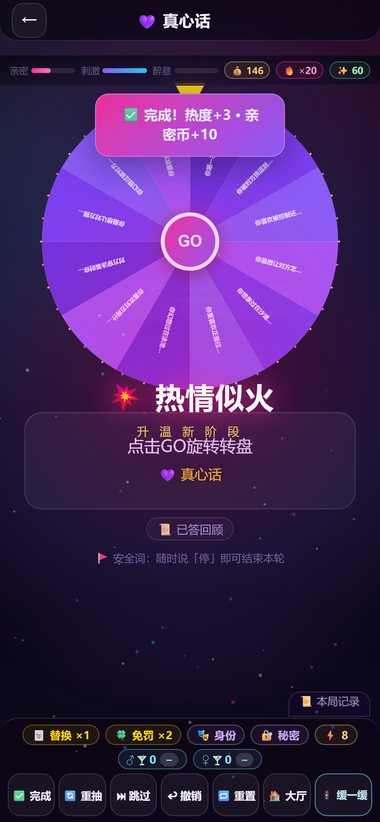
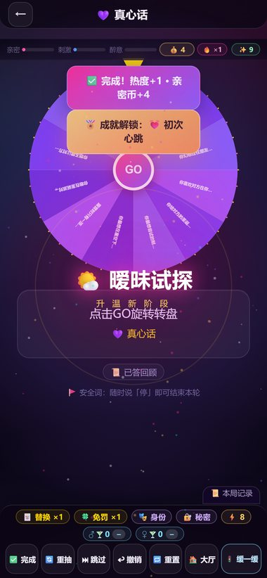
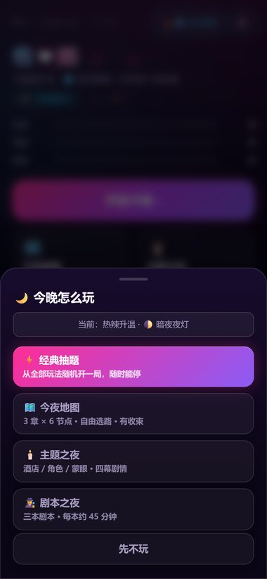
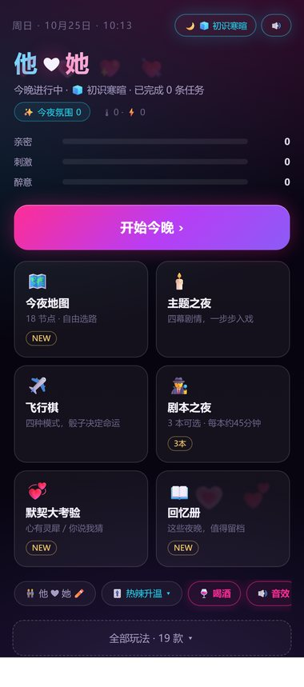
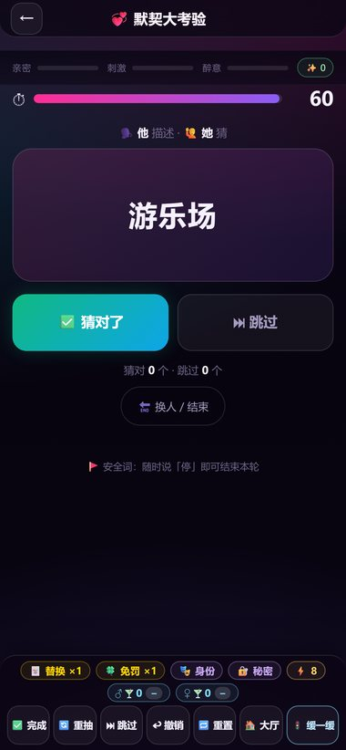
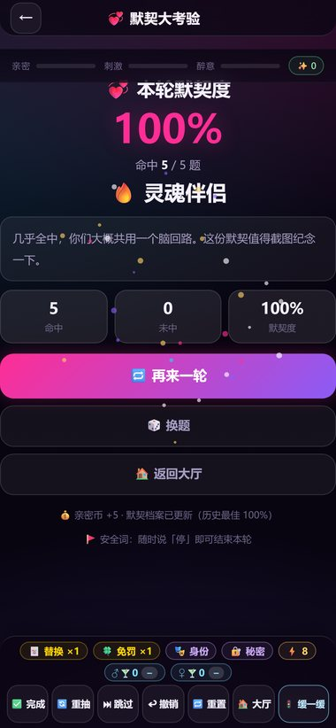
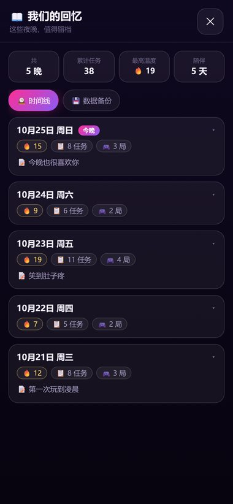

# 💕 情侣升温游戏 Couple Game

> 一款面向情侣/多人的面对面互动网页小游戏 —— **24 款游戏 + V17 默契/回忆扩展 + V18 手感升级**，一台手机，拉近你们的距离。


<p align="center">
  
</p>

## 🆕 V17 更新（2026.10）

| 新功能 | 一句话 |
|------|------|
| 💞 **默契大考验** | 心有灵犀（50 题 / 5·8·10 题 / 两人交替猜心）+ 你说我猜（110 词 / 60·90·120 秒），算默契度与段位 |
| 📖 **我们的回忆册** | 每晚战报自动留档：时间线、最高温度、累计任务、陪伴天数，还能给那晚写一句话 |
| 💾 **数据备份** | 全部本机数据一键导出 JSON / 导入恢复，换手机、清缓存都不丢 |
| 📲 **装到桌面 + 离线可玩** | 支持添加到主屏幕全屏打开；首次打开后断网也能玩；分享链接带预览卡片 |

> 详细更新说明见 [V17-更新说明.md](V17-更新说明.md)。

## 🆕 V18 更新（手感与节奏 · 预览分支）

> 不加新玩法，专修「玩起来的手感、反馈和节奏」。完整说明与数值口径见 [V18-更新说明.md](V18-更新说明.md)。

| 改了什么 | 基线 → V18 |
|---|---|
| 🎡 轮盘手感 | 3400–5800ms → 2200–2900ms + tick 音 + 旋转中 GO 禁用；关动效时死等 **5385ms → ~730ms** |
| ❤️ 正反馈 | 热度条动画复活（原来过渡是死代码）、HUD 常驻 💰/🔥、金币飞入、阶段升级仪式 |
| 🔔 反馈层级 | toast 队列 + 成就独立 lane：不再互相覆盖，也不再压住结果卡/抽屉 |
| ⚖️ 强度加权 | 完成任务按星级给热度/亲密币；20 条任务夜 阶段 1 → 3（💥 热情似火） |
| 🔗 续章降噪 | 每 3 条任务才提示一次续章：20 条夜弹窗 20 → 6 次 |
| 🎫 跳过兜底 | 精力耗尽不再卡死，每晚 2 次免费跳过 |
| ▶️ 首页 CTA | 「开始今晚」→「今晚怎么玩」四入口（经典/地图/主题/剧本），`v12QuickStart` 复活 |

<p>
  
  
  
</p>

## 📸 界面预览

<p>
  
  
  
  
</p>

## 🎮 游戏一览（24 款 + V17 新增 1 款）

| 类别 | 游戏 |
|------|------|
| 经典 6 款 | 💜真心话 · 🔥大冒险 · 💣数字炸弹 · 🎲骰子大冒险 · ✊石头剪刀布 · 🎡惩罚大转盘 |
| 刺激 7 款 | 🔫极限轮盘 · ⛓️越拒绝越刺激 · 🔥同时开火 · 🧎国王小时 · 💥赌徒翻倍 · 🎯敏感点狙击 · 🪢蒙眼服从 |
| 进阶 7 款 | 🎰命运二选一 · 🂡出牌对决 · 📦九宫格盲盒 · ⏱️烫手山芋 · 🏋️体力情话 · 🎭身份扮演 · 💰勇气竞拍 |
| 飞行棋 | ✈️ 四玩法融合（对飞/环岛/双轨/旗舰），男女差异化内容，性别支线，事件卡，身份卡 |
| 全新 3 款 | 💰真心话保险箱 · 👑五分钟国王 · 🎲盲盒骰子 |
| V17 新增 | 💞 默契大考验（心有灵犀 / 你说我猜 · 测测你们多懂彼此） |
| 夜间模式 | 🗺️ 今夜地图（3 章 18 节点随机地图）· 🕯️ 主题之夜（四幕剧情）· 🕵️ 剧本之夜（3 本情感悬疑剧本） |

## ✨ 特色

- 🌓 三主题（暗夜夜灯 / 浅色浪漫 / 手绘情书）+ 🎀 三场景皮肤（海滩 / 圣诞 / 露营）
- 🎚️ 难度 4 档：纯爱温和 → 暧昧甜撩 → 热辣升温 → 极限刺激
- 🎡 任务大转盘：真心话/大冒险选项卡随时切换，3D 真实旋转骰子
- 📊 本晚战报 + 历史累计数据、任务分类徽章、❤ 任务收藏
- 💞 默契大考验：50 道偏好题 + 110 个猜词，测测你们到底多懂彼此
- 📖 回忆册 + 💾 一键备份：每个夜晚都能回看，换手机也不丢数据
- 📲 PWA：装到桌面全屏体验、断网也能玩、分享链接带预览卡
- 🛡️ 安全机制：酒量额度（男≤5杯/女≤3杯，超限自动转亲吻）、半杯特权、弃权卡、安全词
- 📱 纯前端单文件，零后端零付费，全部数据存浏览器 localStorage
- 📈 50 万局虚拟真人试玩验证：0 死锁、100% 完赛

## 🚀 立即游玩

👉 **https://chundongtou.github.io/couple-game/**

> 📲 想更像 App：用 Safari / Chrome 打开后「添加到主屏幕」，之后全屏无地址栏，断网也能玩。
> 提示：用手机自带浏览器打开（部分社交 App 内置浏览器可能拦截安装）；更新后多刷新几次清缓存。

## 🧰 技术栈

- 原生 HTML + CSS + JavaScript 单文件（无框架依赖）
- 自托管字体（Baloo 2 / Quicksand）、Radix Colors 设计系统、Rough.js 手绘风格
- Mermaid 预渲染规则流程图、GitHub Actions 自动部署 Pages
- PWA：Web App Manifest + Service Worker（导航 network-first，静态资源 cache-first）
- 构建：`v17/features/*.js` 由 `tools/build.py` 拼进 `index.html` 注入区，线上仍是单文件

## 🛠️ 本地开发 / 自测

```bash
python tools/build.py              # 构建 dist/（= index.html + manifest/sw/icons）
python tools/dev.py --port 8787    # 构建 + 本地预览（禁缓存；手机同 WiFi 可访问）
python qa/harness.py --smoke       # Playwright 基线冒烟：29 个玩法逐个进入
```

目录：

```
index.html            线上唯一入口（V17/V18 片段已注入）
v17/features/*.js     V17 功能源码（构建时注入，勿手改 index.html 注入区）
v18/features/*.js     V18 手感/数值片段（50-motion / 60-pace）
v18/PLAN.md           V18 实施计划与验收口径
tools/build.py        拼装构建（含 node --check 语法体检）
tools/dev.py          本地预览服务
tools/gen_icons.py    生成 PWA 图标 / 分享图（Pillow）
manifest.webmanifest  PWA 清单
sw.js                 Service Worker
icons/                图标与分享卡
qa/                   Playwright 冒烟 / 验收脚本
docs/v17/ docs/v18/   README 截图
```

## 📋 更新日志

### V18 · 手感与节奏（预览）
- 🎡 轮盘：2200–2900ms + 8–14 tick + GO 禁用；reduce 死等 5385ms → ~730ms；fx=off 3791ms → 974ms
- ❤️ HUD：热度条过渡复活、💰/🔥 常驻、count-up；浮动/飞币/阶段升级仪式/连击脉冲；跳过负反馈
- 🔔 toast：队列 + 双 lane + 顶部安全区 + 180ms 淡出，不再覆盖弹窗/结果卡
- ⚖️ 数值：按任务星级加权（热 `[1,1,2,3,4]`、币 `[3,4,6,8,10]`）；热度阈值 10/22/38/58
- 🔗 节奏：续章弹窗 20 → 6 次/夜；🎫 免费跳过兜底；▶️ 首页 CTA「今晚怎么玩」四入口
- 🚀 降载：粒子 canvas DPR≤2（clear −55.6%），reduce 不建粒子，fx 三档语义修正
- ✅ 独立 QA 60/60 PASS（29 旧玩法 + V17 三功能回归 0 error）

### V17 · 默契与回忆（2026.10）
- 💞 默契大考验：心有灵犀（50 题、5/8/10 题、交替先答/猜、段位结算）+ 你说我猜（110 词、60/90/120 秒、猜对/跳过/提前结束）；新增 `couple-moqi` 默契档案
- 📖 回忆册：本晚战报自动入册（按天去重），时间线/统计/详情/一句话备注/删除
- 💾 数据备份：全部 `couple-*` 数据一键导出 JSON、导入恢复（兼容旧版本数据）
- 📲 PWA：可安装到桌面、离线可玩；补齐 theme-color / apple-touch-icon / og 分享卡
- 🩹 顺手修：游戏页「📜 本局记录 / 🔊 重听」浮标跑到视口外点不到（V16 存量 bug）；移除 V16 唯一一处可选链（iOS < 13.4 白屏）；「📲 装到桌面」移到设置条首位
- 🧰 新增构建与 QA 工具链（`tools/`、`qa/`、`v17/`）；独立 QA 147 项自动化验收全 PASS（[报告](docs/v17/QA-验收报告.md)）

### V16 · 剧本之夜（2026.10）
- 🕵️ 情感悬疑剧本《失踪的第七封信》，之后扩充到 3 本；4 幕 12 线索 / 私密递手机 / 信任选择 / 3 结局

### V15 · 今夜地图（2026.10）
- 🗺️ 3 章 18 节点随机地图、7 类节点、主题与章节目标、Boss 合体与降档、3 结局、存档续玩

### V11–V14 · 氛围与仪式（2026.10）
- 🎴 道具卡 3.0 / 黑市 / 夜终仪式 / 战报海报 / 氛围音；❤ 关系双轨、今晚身份、秘密银行、任务链；极限内容包与露出包

### V12 · 霓虹夜店（2026.10）
- 🎛️ 首页与游戏页换皮、四家族页签、剧情模式 3 章 12 幕、成就墙、全局完成按钮

[更早版本见 commit 记录](https://github.com/chundongtou/couple-game/commits/main)

## ⚠️ 温馨提示

- 本游戏含成人向内容，请情侣双方**自愿参与**，任何一方可随时喊"安全词"终止
- 喝酒玩法请**未成年人勿饮酒，适量为宜**
- 请尊重伴侣边界，游戏目的是升温感情而不是勉强对方
- 无痕模式下所有本机数据会在回大厅时清空；重要记录请先到「回忆册 → 数据备份」导出

## 📄 License

MIT
