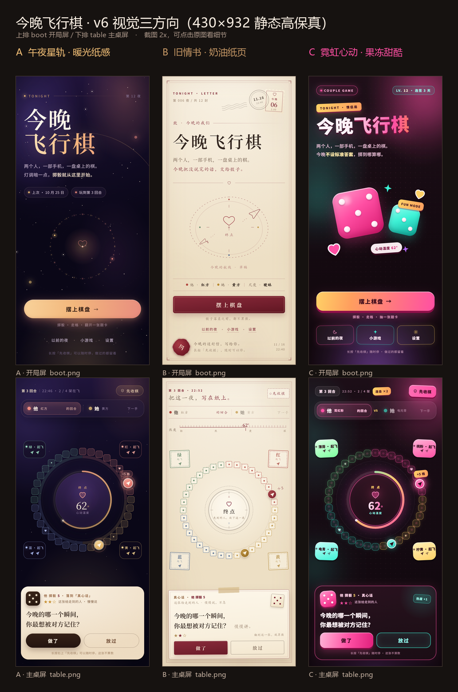

# 今晚飞行棋 · v6 视觉三方向 spike

> 目的：给「今晚飞行棋」下一版视觉定方向。三个明显不同的方向，各 2 屏静态高保真（开局 `boot` + 主桌 `table`），430×932、2x 截图。
>
> 先看总览：

| 方向 | 气质一句话 | 文件 |
|---|---|---|
| **A 午夜星轨 · 暖光纸感** | 深夜星空 + 琥珀玫瑰暖光，玻璃与纸的对比，安静、亲密、有电影感 | [a/boot.html](a/boot.html) · [a/table.html](a/table.html) · [boot.png](a/boot.png) · [table.png](a/table.png) |
| **B 旧情书 · 奶油纸页** | 一封写给今晚的信：奶油纸、酒红火漆、邮票邮戳、手绘航线 | [b/boot.html](b/boot.html) · [b/table.html](b/table.html) · [boot.png](b/boot.png) · [table.png](b/table.png) |
| **C 霓虹心动 · 果冻甜酷** | 深可可底 + 霓虹粉青、果冻骰子与贴纸，甜、酷、直接 | [c/boot.html](c/boot.html) · [c/table.html](c/table.html) · [boot.png](c/boot.png) · [table.png](c/table.png) |

截图均为 **860×1864 PNG（430×932 @2x）**，源文件是单文件 HTML，双击即可在手机尺寸下查看。

---

## A · 午夜星轨 · 暖光纸感（推荐）

- 截图：[boot.png](a/boot.png) / [table.png](a/table.png)
- 开局：宋体大标题「今晚 / 飞行棋」+ 星轨环与两颗行星，玻璃胶囊显示「上次 · 10 月 25 日」；主按钮「摆上棋盘」用琥珀→玫瑰暖光，底下一行小入口「以前的夜 · 小游戏 · 设置」。
- 主桌：顶部玻璃回合条（他 · 红方 / 她 · 黄方）、星轨环形棋盘（36 格、四色起飞区、中心「终点」+ 62° 心动温度环）、暖纸题卡带骰子与「做了 / 放过」，右上「先收棋」。

**配色板**

| 用途 | 色值 |
|---|---|
| 夜空底 | `#08060F` · `#120D24` · `#150F2A` |
| 星云紫 | `#241540` · 光晕 `#8E7BD8` |
| 琥珀暖光 | `#F3C077`（深）`#E2965E` |
| 玫瑰暖光 | `#E9887A` |
| 米白文字 | `#FBF3E7` / 次级 `#C9B6CE` / 弱 `#8E7C9E` |
| 暖纸题卡 | `#F7EAD6` → `#F1DFC4`，字 `#2C1C15` |
| 玻璃面 | `rgba(38,27,58,.42)` + `border rgba(255,226,196,.13)` |
| 四色棋子 | 红 `#F08C80` · 黄 `#F0C877` · 蓝 `#8FA6E8` · 绿 `#7FC9A8` |

**字体栈**：标题/温度数字 `"Noto Serif SC","Songti SC","STSong",serif`；正文 `"Noto Sans SC","Microsoft YaHei","PingFang SC",sans-serif`。标题 74px/600，题卡 20px/600。

**纹理 / 动效关键词**：星点噪点（feTurbulence）、玻璃拟态 `backdrop-blur`、琥珀/玫瑰径向光晕、环形星轨、暖纸纤维；动效语言 = 星轨缓慢旋转、骰子暖光呼吸、题卡上浮、按钮柔光。

- 优点：和「夜里、两个人、一部手机」的场景最贴，暗光护眼，层次最丰富；棋盘最像「棋」，题卡纸感和暗底对比最强。
- 缺点：玻璃 + 多层光晕对低端安卓的性能与非旗舰屏对比度有风险，暖光过量容易滑向「夜店感」，落地要克制发光强度。

---

## B · 旧情书 · 奶油纸页

- 截图：[boot.png](b/boot.png) / [table.png](b/table.png)
- 开局：整屏是一张纸——双细线框、右上邮票 + 邮戳 + 波浪注销线、手写「致 · 今晚的我们」、宋体大标题、手绘航线草图、酒红主按钮、底部火漆「今」与签名。
- 主桌：抬头是「把这一夜，写在纸上。」；回合条为墨线与细线分隔；热度是手绘刻度尺（62°）；棋盘变成信纸上的手绘地图（虚线航线 + 墨框格 + 四枚印章式起飞区 + 中心罗盘）；题卡是一张用胶带贴在纸上的便签，带象牙骰子。

**配色板**

| 用途 | 色值 |
|---|---|
| 奶油纸底 | `#F5EBD9` · `#FCF5E8` · `#EBDCBF` |
| 墨色字 | `#33261F` / 次级 `#6A5344` / 弱 `#947C68` |
| 酒红 | `#7B2231` / 深 `#5E1620` |
| 火漆 | `#8E2432` |
| 烫金 | `#B08D57` |
| 四色墨 | 红 `#B2473F` · 黄 `#B8892F` · 蓝 `#3F5C8A` · 绿 `#4F7B5A` |

**字体栈**：标题/正文 `"Noto Serif SC","Songti SC","STSong","SimSun",serif`；手写批注 `"STKaiti","KaiTi","Kaiti SC",serif`；英文小标签 `"Noto Sans SC"`。标题 53px/600，题卡 19.5px/600。

**纹理 / 动效关键词**：纸纹噪点 + 边缘做旧、双细线框、邮票齿边（clip-path 生成）、邮戳与波浪线、火漆（SVG 位移滤镜）、胶带、虚线手绘；动效语言 = 拆信/翻页、蜡封按下、印章落下、纸页轻抖。

- 优点：仪式感和差异感最强，白天/亮环境也能玩，截图和分享都好看；「写信」叙事天然适合「以前的夜」。
- 缺点：整体偏亮，暗光下不如 A 舒适；装饰元素多，真机上要砍到 2–3 个，否则容易「文创过度」。

---

## C · 霓虹心动 · 果冻甜酷

- 截图：[boot.png](c/boot.png) / [table.png](c/table.png)
- 开局：粗黑体标题带硬投影，霓虹粉/青果冻骰子、贴纸爱心与星星、`FUN MODE` 标签；主按钮「摆上棋盘」糖果渐变 + 硬边底影；三枚贴纸入口。
- 主桌：深可可底 + 半调网点，顶部霓虹回合条（他·霓虹粉 / 她·电光青）与「连击 ×2」贴纸，36 格果冻环形棋盘 + 四色糖牌起飞区、中心 62° 霓虹温度环、果冻棋子与「+5 格」贴纸，底部霓虹题卡与「做了 / 放过」，右上「先收棋」粉贴纸。

**配色板**

| 用途 | 色值 |
|---|---|
| 深可可底 | `#140A10` · `#211019` |
| 霓虹粉 | `#FF4FA3` / 深 `#C3186B` / 影 `#7E0D42` |
| 电光青 | `#3DF2D6` / 深 `#0C9C8D` |
| 柠黄 | `#FFD166` |
| 紫 | `#B96BFF` |
| 薄荷 | `#7CFF9E` |
| 奶白文字 | `#FFF2F7` |

> 四色棋子在 C 里霓虹化为「桃粉 / 柠黄 / 电青 / 薄荷」，对应现有红/黄/蓝/绿，落地时映射回数据里的四色 id 即可。

**字体栈**：全部 `"Noto Sans SC","Microsoft YaHei","PingFang SC",sans-serif`，标题 59px/900，题卡 19px/900，按钮 16px/900。

**纹理 / 动效关键词**：半调网点、模糊霓虹团、果冻高光与内阴影、贴纸白描边、硬投影（0 5px 0）、胶囊圆角；动效语言 = 果冻回弹、骰子滚动、贴纸抖动、按钮按压下沉。

- 优点：最年轻、最有趣，主按钮和三枚入口的点击欲最强；开发最直接（无玻璃/无衬线/无复杂纹理）。
- 缺点：甜酷气质和「私密夜晚」有张力，长时间暗光下高饱和易疲劳；传递的是「好玩」而不是「亲密」，未必适合所有情侣。

---

## 横向对比

| 维度 | A 午夜星轨 | B 旧情书 | C 霓虹心动 |
|---|---|---|---|
| 主色 | 星空紫 + 琥珀/玫瑰 | 奶油纸 + 酒红/墨 | 深可可 + 霓虹粉/青 |
| 字体气质 | 宋体标题 + 无衬线正文（雅） | 宋体 + 楷体（书信） | 粗无衬线 900（潮） |
| 棋盘隐喻 | 星轨环 + 暖光格位 | 信纸上的手绘航线 + 印章 | 果冻跑道 + 贴纸 |
| 题卡 | 暖纸卡（强对比） | 胶带便签（叙事） | 霓虹果冻卡（潮） |
| 夜间舒适度 | ★★★★☆ | ★★☆☆☆ | ★★★☆☆ |
| 仪式感 | ★★★★☆ | ★★★★★ | ★★☆☆☆ |
| 有趣/传播 | ★★★☆☆ | ★★★☆☆ | ★★★★★ |
| 实现成本 | 高（玻璃/光晕/纸纹） | 中高（纸张/齿边/火漆） | 中（纯色块/圆角/贴纸） |
| 与「私密夜晚」贴合 | ★★★★★ | ★★★★☆ | ★★★☆☆ |

## 推荐

**主推 A（午夜星轨 · 暖光纸感）**，理由是：

1. 产品场景是「夜里、两个人、一部手机」，A 的暗底 + 暖光就是场景本身；B 偏「白天写信」，C 偏「派对」。
2. A 的层次最完整：星轨棋盘、玻璃回合条、暖纸题卡三件事各说各的，又互相衬托；题卡在暗底上是天然的视觉焦点（「做了/放过」最显眼）。
3. 星轨 + 飞行棋的「飞」有天然关联，棋盘不需要解释就成立。
4. 落地风险可控：玻璃只用 3 处（回合条、入口胶囊、主按钮高光），其余用渐变 + 纸纹替代，低端机可降级为纯色。

**同时吸收另外两版的局部**：

- 从 B 借「题卡纸感 + 印章式进度」：A 的「以前的夜」列表、回合结束页可以做成信纸/印章，奖励「仪式感」；不要全站换纸底。
- 从 C 借「贴纸 + 果冻骰子」：只放在小游戏入口/彩蛋/成就，作为情绪调剂，避免主桌太甜。

**若要二选一之外的折中**：A 的表盘 + B 的题卡，是成本最低的「A+」；C 单独作为「小游戏」页皮肤。

## 技术说明与已知限制

- 纯 HTML/CSS 单文件：无外链图片/字体/JS；噪点、邮戳、火漆、齿边都用内联 SVG/data URI/滤镜实现；环形 36 格的坐标由少量内联 JS 在静态加载时生成（不依赖网络）。
- 自检结果：6 屏均为 `scrollWidth=430 / scrollHeight=932`，无横向溢出；Playwright 记录到的请求全部是 `file:`/`data:`；无 console error / pageerror；`document.fonts.check` 确认 Noto Serif SC 与 Noto Sans SC 可用。
- 截图环境：Playwright + Edge `channel="msedge"`、headless、viewport 430×932、`device_scale_factor=2`、`locale=zh-CN`。
- 字体依赖：本机可用 `Noto Serif SC`、`Noto Sans SC`、`STKaiti`（华文楷体）。**换到 iOS/其他机器时字体回退会变**（宋体→Songti SC，微软雅黑→PingFang SC），字号与断行需在真机复验（待验证）。
- 这是静态高保真态：动效、长按「先收棋」、真实骰子/落格逻辑未实现；A 的玻璃/光晕、B 的纸张滤镜在低端 Android 上的性能需实机测试（待验证）。
- 截图脚本是临时文件（在 `shots/`，不入库）；如需复跑，用 Playwright 按上面的参数对每个 HTML 截图即可。

